# SOC Security Monitoring & Incident Investigation Lab

**Windows 11 & Ubuntu Linux | Authentication Monitoring | Security Event Analysis | Incident Investigation**

## 1. Project Overview

This project demonstrates a hands-on Security Operations Center (SOC) investigation workflow using Windows 11 and Ubuntu Server virtual machines.

The lab focuses on generating controlled authentication events, analyzing security logs, identifying failed and successful authentication activity, collecting evidence, documenting an incident timeline, and verifying evidence integrity using SHA-256 hashes.

All authentication attempts were intentionally generated within an authorized lab environment. This project does not represent a real-world security breach.

### Project Objectives

- Configure and verify Windows authentication auditing.
- Generate and investigate Windows failed and successful logon events.
- Identify Windows Security Event IDs 4625 and 4624.
- Monitor Linux SSH authentication activity.
- Investigate failed SSH login attempts against a nonexistent account.
- Export relevant Windows and Linux authentication evidence.
- Document investigation findings and an incident timeline.
- Generate and verify SHA-256 hashes for collected evidence.
- Practice SOC investigation and incident documentation workflows.

---

## 2. Lab Environment

| Component | Configuration |
|---|---|
| Host Machine | Apple Silicon Mac (M4, 16 GB RAM) |
| Virtualization | VMware Fusion |
| Windows VM | Windows 11 ARM |
| Ubuntu VM | Ubuntu Server 24.04.4 LTS ARM64 |
| Windows Resources | 2 CPU cores, 4 GB RAM |
| Ubuntu Resources | 2 CPU cores, 6 GB RAM |
| Windows Logging | Windows Event Viewer, Security Logs |
| Linux Logging | systemd journal, OpenSSH |
| Evidence Integrity | SHA-256 |
| Investigation Date | November 6, 2026 |

### Host System and VM Configuration

The lab was designed to operate within the resource constraints of an Apple Silicon Mac while supporting authentication monitoring and investigation across two operating systems.

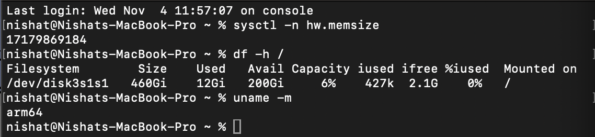

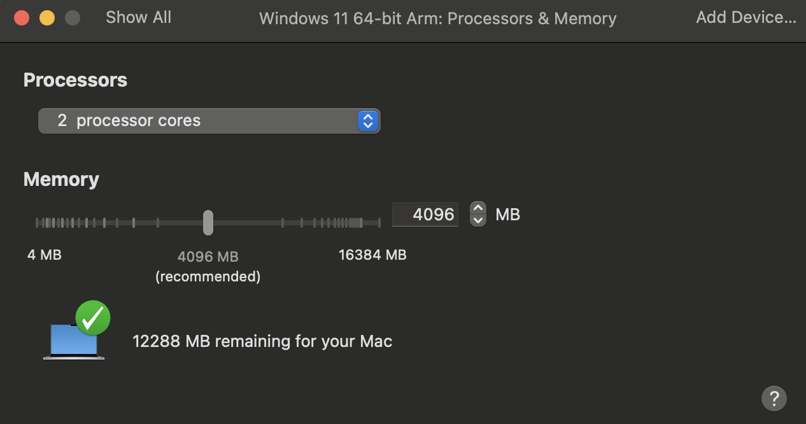

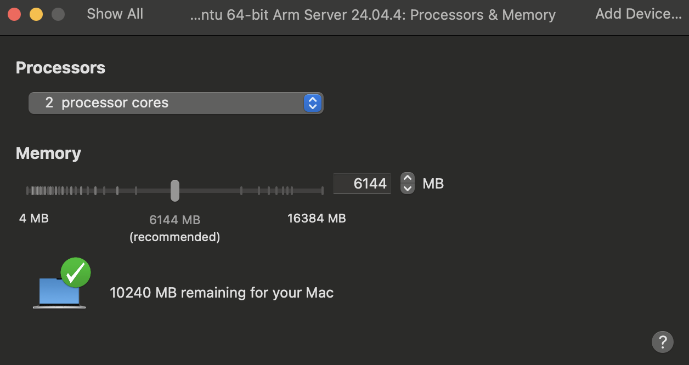

---

## 3. Windows Authentication Monitoring

### 3.1 Authentication Audit Configuration

Windows security auditing was reviewed to confirm that successful and failed logon events could be recorded in the Security event log.

The following command was used in Windows:

```cmd
auditpol /get /category:"Logon/Logoff"
```

The audit policy showed that logon success and failure auditing was enabled.

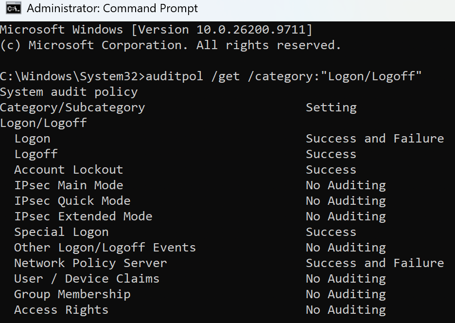

### 3.2 Failed Logon Simulation

A controlled failed authentication attempt was generated using a nonexistent Windows account.

```cmd
runas /user:%COMPUTERNAME%\FakeSOCUser cmd
```

The authentication attempt failed with Windows error 1326, indicating that the supplied username or password was incorrect.

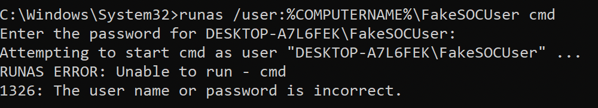

### 3.3 Failed Logon Investigation — Event ID 4625

Windows Event Viewer was used to inspect the Security log for failed authentication events.

**Event ID 4625** identifies a failed account logon.

The investigation identified the following details:

| Field | Observation |
|---|---|
| Event ID | 4625 |
| Event Type | Failed Logon |
| Target Username | FakeSOCUser |
| Status | 0xC000006D |
| Substatus | 0xC0000064 |
| Interpretation | Logon failure involving an account that does not exist |
| Classification | Authorized Lab Simulation |

These details demonstrate how a SOC analyst can use Windows Security events to identify unsuccessful authentication activity and determine the reason for a login failure.

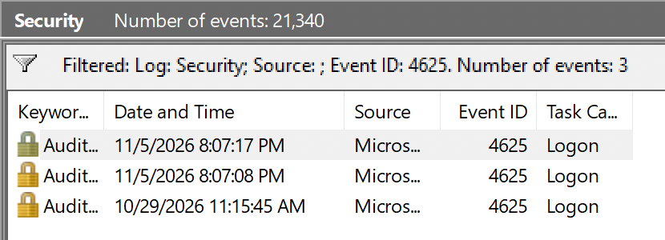

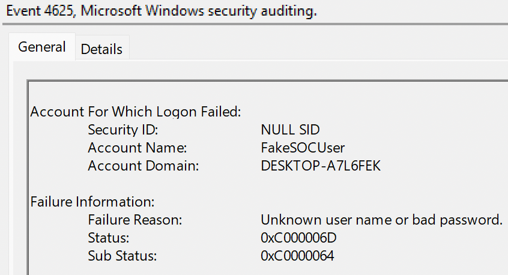

### 3.4 Successful Logon Investigation — Event ID 4624

The investigation also examined **Event ID 4624**, which records successful logon activity.

Successful authentication events were reviewed to distinguish normal system authentication from user logons.

The analysis included reviewing account information and logon context, including a local user authentication event associated with the loopback address `127.0.0.1`.

This comparison demonstrates why successful authentication events must be interpreted using their account and logon details rather than treating every Event ID 4624 as suspicious.

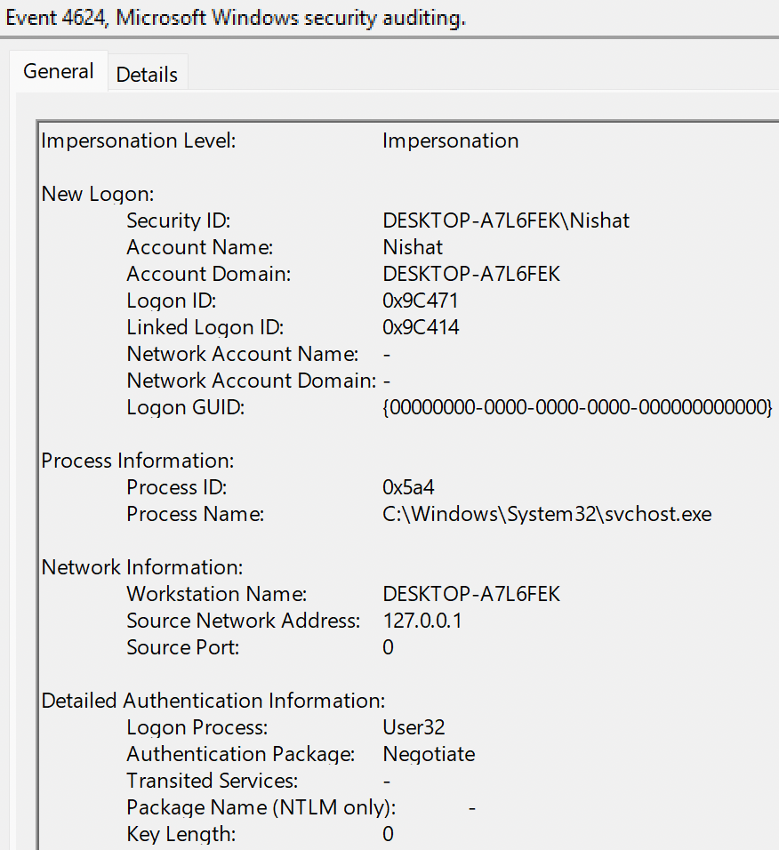

### 3.5 Windows Evidence Export

Relevant Windows Security events were exported from Event Viewer in native `.evtx` format.

The exported evidence files were:

- `windows-failed-logons.evtx`
- `windows-successful-logons.evtx`

These files preserve Windows Event Log records for subsequent investigation.


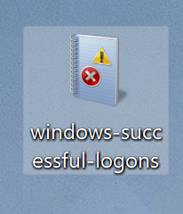

---

## 4. Linux SSH Authentication Monitoring

### 4.1 SSH Authentication Log Review

The Ubuntu server's SSH authentication events were examined using `journalctl`.

```bash
sudo journalctl -u ssh --since "24 hours ago" --no-pager
```

The command displays recent journal entries associated with the SSH service.

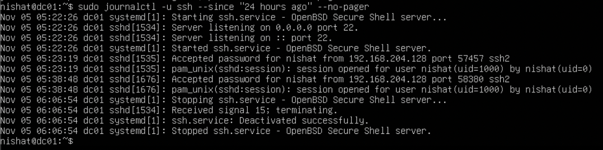

### 4.2 Failed SSH Authentication Simulation

A controlled SSH authentication attempt was performed against a nonexistent Linux account:

```bash
ssh fakeuser@127.0.0.1
```

The server rejected the authentication attempts.

The SSH logs recorded messages including:

```text
Invalid user fakeuser
Failed password for invalid user fakeuser
```

The source address `127.0.0.1` indicates that the attempts originated from the local system.

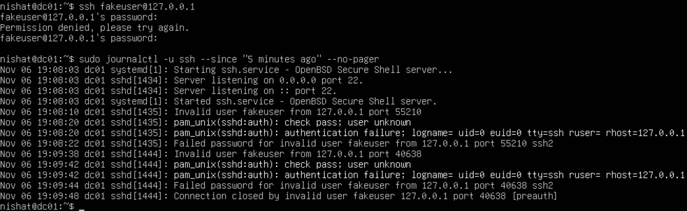

### 4.3 Linux Authentication Log Export

SSH authentication logs were exported into a text file for further analysis.

The collected evidence was saved as:

```text
linux-ssh-authentication.log
```

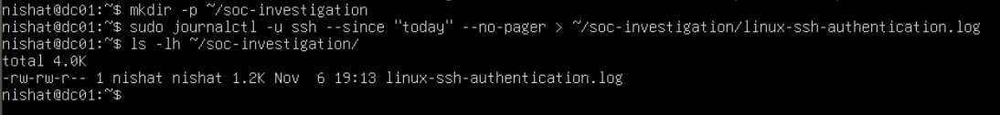

### 4.4 Authentication Event Filtering

The exported log was reviewed using `grep` to identify authentication-related events.

```bash
grep -E "Failed password|Invalid user|Accepted password" linux-ssh-authentication.log
```

The investigation confirmed:

- Two failed SSH password authentication events.
- Authentication attempts against the nonexistent account `fakeuser`.
- Activity originating from the local loopback address.
- No successful authentication to the invalid account in the reviewed events.

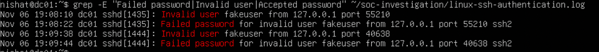

---

## 5. Security Incident Investigation

### Incident Summary

| Field | Details |
|---|---|
| Incident ID | SOC-LAB-001 |
| Incident Type | Failed SSH Authentication |
| Investigation Date | November 6, 2026 |
| Affected System | Ubuntu Server 24.04.4 LTS |
| Hostname | dc01 |
| Target Account | fakeuser |
| Source IP | 127.0.0.1 |
| Classification | Authorized Lab Simulation |
| Final Status | Closed |

### Incident Timeline

| Time | Event | Observation |
|---|---|---|
| 19:08:10 | Invalid User | SSH login attempted for `fakeuser` |
| 19:08:22 | Authentication Failure | First failed password event |
| 19:09:38 | Invalid User | Second SSH login attempt |
| 19:09:44 | Authentication Failure | Second failed password event |

All timestamps correspond to November 6, 2026, as recorded in the investigation timeline.

### Investigation Findings

The investigation identified repeated authentication attempts against an invalid account.

The authentication failures were generated intentionally as part of the controlled lab exercise.

Because the activity originated from `127.0.0.1`, the observed events were consistent with locally generated testing rather than an external source.

The reviewed evidence did not indicate successful unauthorized access or establish a system compromise.

**Investigation Outcome:** Closed — Authorized Security Testing.

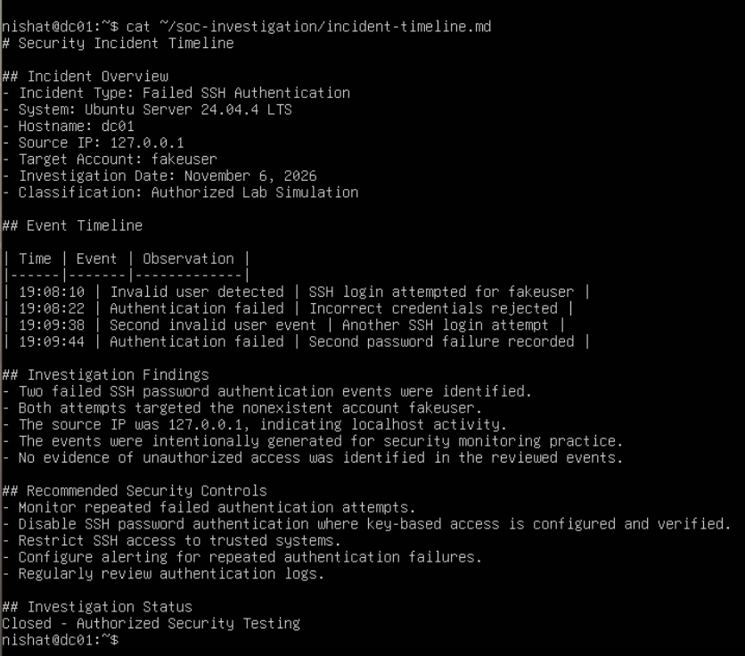

### Incident Documentation

The investigation was documented in two supporting files:

- `incident-timeline.md` — chronological record of the investigated SSH authentication events.
- `soc-incident-report.md` — incident summary, evidence collection, technical analysis, security recommendations, and investigation outcome.

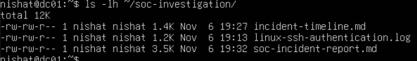

---

## 6. Evidence Integrity and Verification

### 6.1 Linux Evidence Integrity

SHA-256 hashes were generated for the Linux evidence files to establish an integrity baseline.

```bash
sha256sum -c evidence-hashes.sha256
```

The verification process confirmed that the recorded hashes matched the corresponding files.

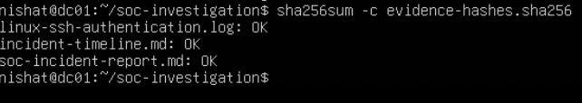

### 6.2 Linux Evidence Transfer

Linux investigation files were transferred from the Ubuntu VM to the macOS host using SCP.

```bash
scp -r nishat@192.168.204.130:/home/nishat/soc-investigation/. ~/Desktop/SOC-Security-Monitoring-Lab/linux-evidence/
```

The transferred files included the SSH authentication log, incident timeline, incident report, and SHA-256 manifest.

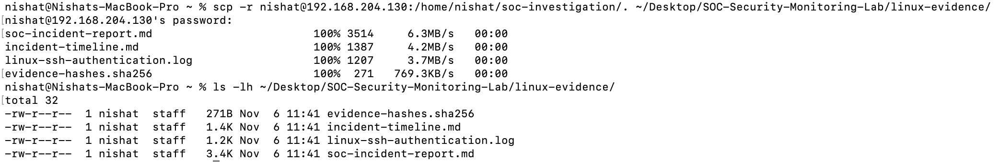

### 6.3 Linux Evidence Verification on macOS

Following the transfer, the Linux evidence hashes were checked on the Mac using:

```bash
shasum -a 256 -c evidence-hashes.sha256
```

All three referenced Linux evidence files passed the integrity verification.

This confirmed that the transferred files matched the SHA-256 values recorded before transfer.

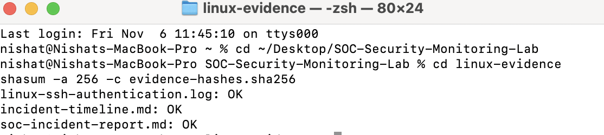

### 6.4 Windows Evidence Transfer

The Windows Event Log files were transferred from the Windows VM to the macOS host using a temporary SMB file share.

After the transfer, SMB account sharing and macOS File Sharing were disabled.

The exported `.evtx` files were retained locally for investigation.

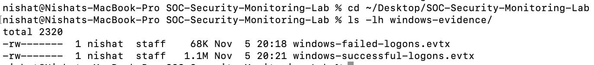

### 6.5 Windows Evidence Integrity Verification

SHA-256 hashes were generated for the Windows evidence files on macOS.

```bash
shasum -a 256 windows-failed-logons.evtx windows-successful-logons.evtx > windows-evidence-hashes.sha256
```

The hashes were subsequently verified using:

```bash
shasum -a 256 -c windows-evidence-hashes.sha256
```

Both Windows evidence files passed verification against the macOS-generated hash manifest.

This established and verified a local integrity baseline for the collected Windows evidence. It does not independently prove that the files were unchanged during transfer from Windows.

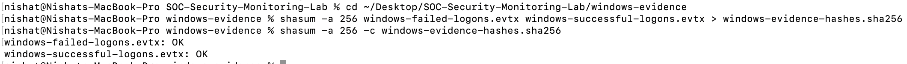

---

## 7. Security Recommendations

Based on the authentication monitoring exercises, the following security controls are recommended:

1. Monitor failed authentication events across Windows and Linux systems.
2. Investigate repeated login failures involving nonexistent or unexpected accounts.
3. Configure alerting for unusual authentication patterns.
4. Restrict SSH access to authorized systems and users.
5. Prefer SSH key-based authentication where appropriately configured.
6. Review Windows Security Event IDs 4624 and 4625 together to understand authentication context.
7. Maintain secure evidence storage and document evidence handling procedures.
8. Use cryptographic hashes to detect changes to collected evidence.

---

## 8. Skills Demonstrated

**Security Monitoring**
- Windows Security Event Log analysis
- Linux SSH authentication monitoring
- Successful and failed authentication investigation
- Event filtering and interpretation

**Incident Investigation**
- Security event triage
- Authentication failure analysis
- Incident timeline development
- Investigation documentation
- Security recommendations

**Evidence Handling**
- Windows Event Log export
- Linux journal log export
- SCP and SMB file transfer
- SHA-256 hashing and integrity verification
- Evidence organization

**Tools and Technologies**
- VMware Fusion
- Windows Event Viewer
- Windows `auditpol` and `runas`
- Ubuntu Linux
- OpenSSH
- `journalctl`
- `grep`
- `scp`
- `sha256sum` and `shasum`

---

## 9. Project Outcome

This lab demonstrated a practical, manually conducted SOC investigation workflow across Windows and Linux environments.

The Windows investigation focused on analyzing successful and failed authentication events using Windows Security Event IDs 4624 and 4625.

The Linux investigation focused on identifying failed SSH authentication attempts, reviewing relevant logs, documenting an incident timeline, and preparing an incident report.

Both investigations included evidence collection and integrity verification activities.

The project strengthened hands-on experience in security monitoring, event analysis, incident documentation, and evidence handling.

**Note:** This lab used native operating system logging and command-line investigation tools. It did not deploy a centralized SIEM, EDR platform, or automated detection system.

---

## 10. Repository Contents

```text
SOC-Security-Monitoring-Lab/
├── README.md
├── screenshots/
│   ├── 01-host-system-resource-assessment.png
│   ├── 02-windows-vm-resource-allocation.png
│   ├── ...
│   └── 21-windows-evidence-integrity-verification.png
├── linux-evidence/
│   ├── incident-timeline.md
│   ├── soc-incident-report.md
│   └── evidence-hashes.sha256
└── windows-evidence/
    └── windows-evidence-hashes.sha256
```

Raw authentication logs and Windows `.evtx` files are retained locally and are not intended for publication in the public repository.

Screenshots and supporting documents should be reviewed for sensitive information before publication.

---

## 11. Disclaimer

All authentication activities were performed in an isolated, authorized lab environment for educational and professional development purposes.

The simulated events do not represent a real security incident or unauthorized access to third-party systems.
